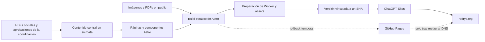

# Arquitectura de REDRYS

## Contexto y objetivos

REDRYS es un sitio institucional de consulta pública. Su función es presentar
la red, sus objetivos, líneas de investigación, integrantes, datos de contacto
y documentos fundacionales.

La arquitectura prioriza:

- Contenido HTML rastreable y accesible sin depender de JavaScript.
- Operación sencilla para un responsable técnico individual.
- Coste y mantenimiento bajos.
- Contenido institucional centralizado y fácil de revisar.
- Publicación reproducible con respaldo en GitHub.

No forman parte de la arquitectura actual:

- Backend o API.
- Autenticación y cuentas de usuario.
- Base de datos o CMS.
- Formularios que almacenen o envíen información.
- Carga de publicaciones por terceros.
- Búsqueda dinámica.

## Vista general

GitHub es la fuente de verdad del código y del historial. El proveedor que
atiende `redrys.org` depende del estado de la migración; el DNS debe apuntar a
un solo proveedor. GitHub Pages no atiende el dominio mientras este resuelve a
Sites y solo puede volver a hacerlo mediante el procedimiento de rollback. El
estado y rollback se registran en `docs/migracion-chatgpt-sites.md`.

## Capas y responsabilidades

### Contenido institucional

El contenido vive en dos capas según su naturaleza.

**Datos estructurados cortos y estables** en `src/data/`:

- `site.ts`: identidad, contacto, dirección postal, sede, navegación y footer.
- `integrantes.ts`: directorio público y datos de perfil académico.
- `objetivos.ts`: objetivo general y objetivos específicos.

**Textos largos** en `src/content/`, como Content Collections de Astro:

- `lineas/`: una ficha Markdown por línea de investigación.
- `documentos/`: una ficha Markdown por documento fundacional.

`src/content.config.ts` define los esquemas Zod. Son deliberadamente estrictos:
cada ficha debe declarar su `fuente` y su `aprobacion`. Una ficha cuyo origen no
esté documentado **no compila**. Esto convierte la regla editorial en una
restricción del build, no en una convención que dependa de la memoria de quien
edita.

Estos archivos son la fuente de contenido para el build, pero no la autoridad
institucional. La procedencia, adaptaciones y aprobaciones se controlan en
`docs/FUENTES-Y-PENDIENTES.md`.

### Presentación

- `src/pages/` define las rutas públicas y la página 404, incluidas las rutas
  dinámicas `lineas-investigacion/[slug]`, `documentos/[slug]` e
  `integrantes/[slug]`.
- `src/components/` contiene navegación, footer, breadcrumbs, títulos, fichas de
  integrante, el bloque de procedencia y el índice de documento.
- `src/layouts/BaseLayout.astro` crea la estructura HTML común, metadata
  social, canonical, breadcrumbs y JSON-LD.
- `src/lib/schema.ts` construye los nodos de datos estructurados.
- `src/lib/reglamento.ts` deriva los anclajes de los artículos del reglamento.
- `src/styles/global.css` contiene tokens, tipografía, responsive y estilos de
  componentes.

El sitio no usa React, Vue ni Svelte y **no envía JavaScript al navegador**. El
menú móvil funciona con un checkbox y CSS; el checkbox se oculta visualmente sin
`display: none` para que siga siendo alcanzable con el teclado.

### Citas normativas resueltas en build

Seis páginas citan artículos concretos del reglamento. Esas citas no se escriben
a mano: `src/lib/reglamento.ts` lee los encabezados del Markdown publicado y
devuelve el anclaje real de cada artículo.

La consecuencia importante es que **una cita a un artículo inexistente rompe el
build**. Si se reenumera o se retira un artículo del reglamento, la compilación
falla en lugar de publicar un enlace que apunta a ninguna parte. El índice del
documento se construye del mismo modo, así que tampoco hay una lista de
secciones que mantener en paralelo al texto.

### Perfiles de integrante

Una persona obtiene página propia solo si su registro en `integrantes.ts` tiene
`slug`. Sin `slug` aparece en el directorio pero no genera ruta. Esto evita
publicar perfiles vacíos y permite incorporar personas de una en una conforme se
documenten y autoricen sus datos.

### Sistema visual

`src/styles/global.css` no es una hoja de estilos acumulada: es un sistema con
cuatro reglas explícitas, y cada una responde a un defecto medido del diseño
anterior.

**Dos voces tipográficas con una regla.** La serif (Source Serif 4) compone el
texto institucional: títulos y prosa transcrita del acta y del reglamento. La
sans (Source Sans 3) compone el aparato que rodea a ese texto: navegación,
etiquetas, metadatos y controles. La distinción es semántica, no decorativa, y
permite decidir sin dudar qué familia usa un elemento nuevo.

**Dos lenguajes de contenedor, no nueve.** `record` es una ficha que lleva a otra
página: superficie, borde y toda su área clicable. `panel` agrupa datos que no
llevan a ninguna parte. Todo lo demás (objetivos, comisiones, estructura, listas
de términos) se separa con filetes y espacio. Antes existían nueve variantes de
caja blanca con borde para nueve cosas distintas, de modo que ser una tarjeta
había dejado de comunicar nada.

**Escala de color opaca y verificada.** No hay grises por opacidad. La cabecera
de `global.css` documenta el contraste medido de cada token contra los dos
fondos del sitio. La escala anterior, construida con `rgba(13,47,54,α)`,
reprobaba WCAG AA en once selectores, entre ellos las etiquetas de contacto, la
adscripción de los integrantes, la procedencia y el pie completo.

**El verde significa algo.** `--color-ratified` marca el contenido respaldado por
un documento institucional y distingue una transcripción de una redacción
editorial pendiente de ratificación. Es el mismo valor que el esquema Zod obliga
a declarar en cada ficha; antes ese estado existía en los datos pero no llegaba
a la pantalla, y el color solo pintaba dos ornamentos de 2 px.

El sitio es de tema claro único. El modo oscuro no está implementado.

#### Texto justificado

El texto corrido se justifica, como en una publicación académica impresa. En
pantalla eso solo funciona con partición de palabras: sin `hyphens: auto`,
justificar en español abre ríos de blanco entre palabras largas.

Se aplica únicamente donde la medida lo aguanta (unos 60 caracteres o más):
resumen del hero, prosa institucional, subtítulos de sección y el texto
transcrito. Los resúmenes de ficha, los pies, los metadatos y las listas cortas
siguen alineados a la izquierda **a propósito**: en columnas estrechas la
justificación produce huecos enormes entre palabras.

Es una decisión de registro, tomada a petición expresa, y tiene un coste
documentado: WCAG 1.4.8 (nivel AAA) desaconseja el texto justificado porque el
espaciado irregular dificulta el seguimiento de línea a personas con dislexia.
El sitio apunta a AA, no a AAA, y la partición de palabras mitiga el efecto.
Revertirlo es retirar una regla de `global.css`.

#### Imágenes

Las fotografías viven en `src/assets/` y se procesan con `astro:assets`, no en
`public/`. El build genera las derivadas WebP con `srcset`, fija `width` y
`height` en el marcado y sirve el tamaño que corresponde a cada viewport. Eso es
lo que mantiene el CLS en cero: una imagen sin dimensiones declaradas
reintroduciría el desplazamiento de maquetación que costó eliminar de las
tipografías.

`public/images/` conserva el logotipo y la imagen social, que necesitan una URL
estable y sin hash porque los consumen el favicon y las tarjetas de Open Graph.

La fotografía de la portada se publica como banda a ancho completo. Una escena
ancha en una columna lateral estrecha se lee como una miniatura de manchas de
color; a ancho completo recupera su contenido y deja de competir con el titular.
Se desatura al 60 % porque los colores de la escena eran los más saturados de la
página y peleaban con el acento de la marca.

#### La procedencia como estructura

El bloque de procedencia y el estado de aprobación viven en la columna lateral
de las páginas de línea, documento y perfil, junto al texto que describen. Antes
se servían al final de la página, en gris, dentro de un borde punteado.

Esa columna existía y estaba vacía: el contenido se limita a la medida de
lectura y dejaba en torno al 40 % del ancho sin usar en escritorio. Ahora
sostiene el aparato del documento: procedencia, estado de aprobación, fecha de
revisión y, en el reglamento, el índice.

### Assets y documentos

Astro copia los archivos de `public/` a su salida estática. La preparación para
Sites conserva los assets públicos, salvo archivos exclusivos del proveedor
anterior:

- `public/images/`: logo e imagen de previsualización social.
- `public/docs/`: acta constitutiva y reglamento.
- `public/fonts/`: tipografías autoalojadas y sus licencias SIL OFL.
- `public/robots.txt`: reglas de indexación del dominio canónico.
- `public/CNAME`: configuración exclusiva de GitHub Pages durante la
  transición; `scripts/prepare-sites-build.mjs` la excluye del artefacto de
  Sites.

Las tipografías se sirven desde el propio dominio. Antes venían de
`fonts.googleapis.com`, en una cadena de tres saltos a un tercero que era la
única dependencia externa del sitio y la causa medida de todo su layout shift.
Los archivos `.woff2` se versionan en el repositorio a propósito: el sitio no
debe depender de `node_modules` ni de un CDN para renderizar su texto. Los
paquetes de `@fontsource-variable` viven en `devDependencies` y solo documentan
la procedencia verificable de esos archivos; `npm run sync:fonts` los actualiza.

La carpeta no debe contener originales privados, documentos sin autorización,
credenciales ni archivos que no deban descargarse públicamente.

### SEO y descubrimiento

Astro recibe `https://redrys.org` como URL del sitio en `astro.config.mjs`.
`BaseLayout.astro` genera:

- Títulos y descripciones por página, con un máximo de 75 caracteres de título.
- URL canonical absoluta, omitida en la página 404 porque `/404/` no existe.
- Open Graph y Twitter Cards, con dimensiones declaradas de la imagen social.
- JSON-LD en grafo.
- `noindex, follow` para la 404 y para las secciones en preparación.

#### Datos estructurados

`src/lib/schema.ts` emite un `@graph` en lugar de un objeto suelto repetido:

| Nodo | Dónde | Por qué |
| --- | --- | --- |
| `ResearchOrganization` | Todas las páginas, con `@id` estable | Describe la red mejor que `EducationalOrganization`: la REDRYS promueve investigación, no imparte programas educativos (Reglamento, Art. 1) |
| `WebSite` | Solo la portada | Una sola declaración del sitio como entidad |
| `WebPage` | Todas las páginas indexables | Aporta `dateModified` como señal de frescura |
| `BreadcrumbList` | Rutas de segundo nivel | Acompaña a una jerarquía de navegación real |
| `DigitalDocument` | `/documentos/<slug>/` | Documentos institucionales que existen y están publicados |
| `Person` | `/integrantes/<slug>/` | Solo para integrantes con perfil académico documentado |

La regla que gobierna esta tabla: **ningún tipo de esquema se declara sin
contenido que lo respalde**. No hay `ScholarlyArticle` porque no hay
publicaciones publicadas; no hay `Event` porque no hay eventos; no hay `sameAs`
porque no se han recopilado perfiles verificados. Añadirlos antes de tiempo
sería marcado que no describe la página.

#### Sitemap

`@astrojs/sitemap` genera `sitemap-index.xml` y `sitemap-0.xml`. La
configuración añade `lastmod` desde una constante explícita —no desde la fecha
de build, que cambiaría en cada compilación sin que el contenido varíe— y filtra
las rutas sin contenido suficiente.

La verificación exige títulos únicos y acotados, metadata completa, un solo H1
por página, JSON-LD válido con la entidad referenciable, un mínimo de 200
palabras en las rutas indexables, ausencia de dominios externos no autorizados,
correspondencia exacta entre sitemap y rutas indexables, y preservación exacta
de imágenes y PDFs.

## Build y publicación

### Build estático estándar

`npm run build` ejecuta Astro y genera `dist/`. La acción
`.github/workflows/deploy.yml` instala dependencias, construye el sitio y
publica ese directorio en GitHub Pages cuando hay cambios en `main`.

Este camino se conserva de forma temporal durante la migración. Un despliegue
de Pages no actualiza ChatGPT Sites ni cambia el proveedor al que apunta el
DNS. Después de la autorización final, el workflow se sustituirá por una
validación sin permisos de Pages.

### Artefacto para ChatGPT Sites

`npm run build:sites` realiza dos etapas:

1. Astro genera la salida estática.
2. `scripts/prepare-sites-build.mjs` reorganiza el resultado:
   - **Recorre `dist/` y descubre todas las páginas HTML generadas.** Las rutas
     no se mantienen a mano: añadir una página a `src/pages/` basta para que
     quede incluida en el artefacto.
   - Inserta esas rutas, el HTML, robots y sitemaps en el Worker generado.
   - Conserva imágenes, estilos y PDFs en `dist/client/`.
   - Genera el punto de entrada `dist/server/index.js`.
   - Copia la configuración permitida a `dist/.openai/hosting.json`.

`sites/worker.mjs` sirve el HTML interno y delega los demás assets al
almacenamiento estático del entorno. Se exporta como `createWorker({ pageRoutes })`
para poder probarlo sin depender del artefacto generado; el `export default` usa
las rutas inyectadas en el build.

Antes, la lista de rutas estaba escrita a mano en tres lugares —el Worker, el
script de preparación y el de verificación— y cada página nueva exigía
recordarlos todos. Ese acoplamiento desapareció.

### Versiones y despliegues de Sites

GitHub y Sites cumplen funciones distintas:

1. GitHub conserva el código, la revisión y el historial.
2. El build validado se asocia al SHA exacto que existe en GitHub.
3. Sites guarda ese artefacto como una versión identificable.
4. Una operación explícita despliega la versión seleccionada en producción.

Un push, incluso a `main`, no publica por sí solo en Sites. El dominio
personalizado permanece conectado al mismo proyecto entre versiones; no se
repiten cambios DNS para una actualización normal. Como cada despliegue de
Sites es productivo, la revisión local y las verificaciones deben completarse
antes de desplegar.

### Verificación

`npm run verify:sites` es la puerta de calidad antes de publicar:

1. Ejecuta `tests/sites-worker.test.mjs`.
2. Compila y prepara el artefacto de Sites.
3. Ejecuta `scripts/verify-sites-build.mjs`.

La verificación comprueba el Worker, todas las rutas descubiertas, SEO, datos
estructurados, sitemap, 404, archivos estáticos y estructura del artefacto.
También comprueba que la configuración de hosting no incluya claves inesperadas.

Dos umbrales de la verificación son decisiones editoriales convertidas en
código: el mínimo de 200 palabras para que una ruta pueda ser indexable, y la
lista de dominios externos permitidos, que impide reintroducir imágenes de
stock o recursos de terceros sin advertirlo.

`fonts.googleapis.com` y `fonts.gstatic.com` salieron de esa lista al autoalojar
las tipografías. Reintroducir una hoja de estilos de Google Fonts ahora falla la
verificación en lugar de pasar inadvertida.

## Comportamiento HTTP

El Worker aplica estas reglas:

- Acepta `GET` y `HEAD`; otros métodos reciben `405`.
- Redirige `www.redrys.org` a `redrys.org`, conservando ruta y query.
- Redirige páginas sin slash final a su variante canónica.
- Devuelve la página 404 con estado HTTP `404`.
- No expone rutas internas del Worker.
- Sirve el dominio canónico como indexable.
- Añade `X-Robots-Tag: noindex, nofollow` al dominio temporal de Sites.
- Entrega un `robots.txt` bloqueado en el dominio temporal.

La separación evita que el dominio provisional compita con `redrys.org` en
buscadores.

## Decisiones y trade-offs

### Astro estático

Se eligió porque el contenido cambia con poca frecuencia y no requiere
sesiones ni persistencia. A cambio, cada cambio necesita un nuevo build y
despliegue.

### Contenido en TypeScript y en Content Collections

Los datos cortos y estables siguen en TypeScript: para 22 integrantes y cuatro
objetivos, una colección sería sobreingeniería.

Los textos largos —líneas de investigación y documentos— pasaron a Content
Collections porque el problema que resuelven es real aquí: editar 650 palabras
dentro de un literal de plantilla es incómodo, y la validación Zod impide
publicar una ficha sin declarar su procedencia. Ninguna de las dos capas es un
CMS: una persona con acceso al repositorio debe editar y publicar.

### Perfiles opcionales en lugar de perfiles vacíos

Se descartó generar 22 perfiles de integrante rellenando los huecos. Una página
de 40 palabras con un nombre y una sigla no aporta nada a quien la visita y
diluye el sitio. El `slug` opcional permite que la arquitectura exista completa
mientras el contenido llega persona a persona.

### GitHub como fuente de verdad

Conserva historial, revisión y recuperación del código. La publicación en
Sites debe asociarse al mismo SHA validado para mantener trazabilidad.

### Sites con rollback temporal en Pages

El Site definitivo ya está desplegado y sus dominios personalizados se
encuentran en validación. GitHub Pages es únicamente el respaldo temporal.
Esta redundancia facilita el rollback, pero no significa que ambos sirvan el
dominio al mismo tiempo. El proveedor activo lo determina el DNS y cualquier
reversión debe seguir la bitácora de migración.

### Tipografías versionadas en lugar de instaladas

Los `.woff2` están en `public/fonts/` y en el historial de Git, aunque también
existan en `node_modules`. Duplicar archivos binarios en un repositorio no es
gratuito, pero la alternativa es peor: un sitio institucional público cuyo texto
depende de que una instalación de npm reproduzca exactamente el mismo archivo.
`npm run sync:fonts` mantiene el vínculo con la fuente verificable sin convertir
`node_modules` en una dependencia de runtime.

### Un solo tema claro

No hay modo oscuro. Añadirlo obliga a decidir la paleta oscura de la marca, y
esa decisión pertenece a la coordinación, no al responsable técnico. Los tokens
están preparados para soportarlo (todo el color pasa por custom properties
semánticas), pero declararlo antes de tener una paleta aprobada produciría un
modo oscuro genérico que no representa a la red.

### PDFs como documentos independientes

Los originales se preservan como evidencia institucional descargable y el
sitio presenta resúmenes en HTML. Esto mantiene el carácter documental, pero
requiere revisar privacidad, accesibilidad y autorización antes de reemplazar
o publicar nuevas versiones.

## Seguridad y privacidad

El sitio no recibe datos de usuarios ni mantiene secretos de runtime. Aun así:

- Todo contenido de `public/` debe considerarse mundialmente accesible.
- `.openai/hosting.json` solo puede contener claves admitidas y nunca
  credenciales, tokens o valores DNS.
- No se deben copiar firmas o datos personales a Markdown.
- Un documento institucional nuevo necesita autorización explícita antes de
  publicarse.
- Las modificaciones de contacto e integrantes deben quedar trazadas.

## Cuándo reevaluar la arquitectura

La solución estática deja de ser suficiente si REDRYS necesita alguna de estas
capacidades:

- Repositorio con carga frecuente, filtros, búsqueda o cientos de registros.
- Administración del contenido por varias personas sin acceso a Git.
- Formularios de afiliación, contacto o recepción de trabajos.
- Cuentas, permisos o contenido privado.
- Integración automática con repositorios académicos externos.
- Publicación continua por editores no técnicos.

En ese momento se debe evaluar un CMS o fuente estructurada, búsqueda y un
backend limitado. No deben añadirse anticipadamente mientras el sitio siga
siendo institucional y de actualización ocasional.
