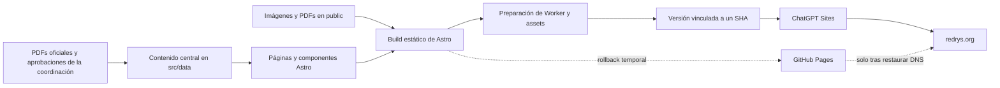

# Arquitectura de REDRYS

## Contexto y objetivos

REDRYS es un sitio institucional de consulta pública. Su función es presentar
la red, sus objetivos, líneas de investigación, integrantes, datos de contacto
y documentos fundacionales.

La arquitectura prioriza:

- Contenido HTML rastreable y accesible sin depender de JavaScript.
- Operación sencilla para un responsable técnico individual.
- Coste y mantenimiento bajos.
- Contenido institucional centralizado y fácil de revisar.
- Publicación reproducible con respaldo en GitHub.

No forman parte de la arquitectura actual:

- Backend o API.
- Autenticación y cuentas de usuario.
- Base de datos o CMS.
- Formularios que almacenen o envíen información.
- Carga de publicaciones por terceros.
- Búsqueda dinámica.

## Vista general

GitHub es la fuente de verdad del código y del historial. El proveedor que
atiende `redrys.org` depende del estado de la migración; el DNS debe apuntar a
un solo proveedor. GitHub Pages no atiende el dominio mientras este resuelve a
Sites y solo puede volver a hacerlo mediante el procedimiento de rollback. El
estado y rollback se registran en `docs/migracion-chatgpt-sites.md`.

## Capas y responsabilidades

### Contenido institucional

`src/data/` centraliza los valores reutilizados por las páginas:

- `site.ts`: identidad, contacto, sede, navegación y footer.
- `integrantes.ts`: directorio público.
- `objetivos.ts`: objetivo general y objetivos específicos.
- `lineas.ts`: líneas de investigación y sus descripciones.

Estos archivos son la fuente de contenido para el build, pero no la autoridad
institucional. La procedencia, adaptaciones y aprobaciones se controlan en
`docs/FUENTES-Y-PENDIENTES.md`.

### Presentación

- `src/pages/` define las siete rutas públicas y la página 404.
- `src/components/` contiene navegación, footer, títulos y tarjetas
  reutilizables.
- `src/layouts/BaseLayout.astro` crea la estructura HTML común, metadata
  social, canonical y JSON-LD.
- `src/styles/global.css` contiene tokens, tipografía, responsive y estilos de
  componentes.

El sitio no usa React, Vue ni Svelte. El menú móvil funciona con HTML y CSS,
por lo que la salida pública requiere muy poco JavaScript.

### Assets y documentos

Astro copia los archivos de `public/` a su salida estática. La preparación para
Sites conserva los assets públicos, salvo archivos exclusivos del proveedor
anterior:

- `public/images/`: logo e imagen de previsualización social.
- `public/docs/`: acta constitutiva y reglamento.
- `public/robots.txt`: reglas de indexación del dominio canónico.
- `public/CNAME`: configuración exclusiva de GitHub Pages durante la
  transición; `scripts/prepare-sites-build.mjs` la excluye del artefacto de
  Sites.

La carpeta no debe contener originales privados, documentos sin autorización,
credenciales ni archivos que no deban descargarse públicamente.

### SEO y descubrimiento

Astro recibe `https://redrys.org` como URL del sitio en `astro.config.mjs`.
`BaseLayout.astro` genera:

- Títulos y descripciones por página.
- URL canonical absoluta.
- Open Graph y Twitter Cards.
- JSON-LD de tipo `EducationalOrganization`.
- `noindex, nofollow` para la página 404 cuando corresponde.

`@astrojs/sitemap` genera `sitemap-index.xml` y `sitemap-0.xml`. La verificación
exige títulos únicos, metadata completa, HTML principal rastreable, siete
rutas en el sitemap y preservación exacta de imágenes y PDFs.

## Build y publicación

### Build estático estándar

`npm run build` ejecuta Astro y genera `dist/`. La acción
`.github/workflows/deploy.yml` instala dependencias, construye el sitio y
publica ese directorio en GitHub Pages cuando hay cambios en `main`.

Este camino se conserva de forma temporal durante la migración. Un despliegue
de Pages no actualiza ChatGPT Sites ni cambia el proveedor al que apunta el
DNS. Después de la autorización final, el workflow se sustituirá por una
validación sin permisos de Pages.

### Artefacto para ChatGPT Sites

`npm run build:sites` realiza dos etapas:

1. Astro genera la salida estática.
2. `scripts/prepare-sites-build.mjs` reorganiza el resultado:
   - Inserta las rutas HTML, robots y sitemaps en el Worker generado.
   - Conserva imágenes, estilos y PDFs en `dist/client/`.
   - Genera el punto de entrada `dist/server/index.js`.
   - Copia la configuración permitida a `dist/.openai/hosting.json`.

`sites/worker.mjs` sirve el HTML interno y delega los demás assets al
almacenamiento estático del entorno.

### Versiones y despliegues de Sites

GitHub y Sites cumplen funciones distintas:

1. GitHub conserva el código, la revisión y el historial.
2. El build validado se asocia al SHA exacto que existe en GitHub.
3. Sites guarda ese artefacto como una versión identificable.
4. Una operación explícita despliega la versión seleccionada en producción.

Un push, incluso a `main`, no publica por sí solo en Sites. El dominio
personalizado permanece conectado al mismo proyecto entre versiones; no se
repiten cambios DNS para una actualización normal. Como cada despliegue de
Sites es productivo, la revisión local y las verificaciones deben completarse
antes de desplegar.

### Verificación

`npm run verify:sites` es la puerta de calidad antes de publicar:

1. Ejecuta `tests/sites-worker.test.mjs`.
2. Compila y prepara el artefacto de Sites.
3. Ejecuta `scripts/verify-sites-build.mjs`.

La verificación comprueba Worker, siete rutas, SEO, sitemap, 404, archivos
estáticos y estructura del artefacto. También comprueba que la configuración
de hosting no incluya claves inesperadas.

## Comportamiento HTTP

El Worker aplica estas reglas:

- Acepta `GET` y `HEAD`; otros métodos reciben `405`.
- Redirige `www.redrys.org` a `redrys.org`, conservando ruta y query.
- Redirige páginas sin slash final a su variante canónica.
- Devuelve la página 404 con estado HTTP `404`.
- No expone rutas internas del Worker.
- Sirve el dominio canónico como indexable.
- Añade `X-Robots-Tag: noindex, nofollow` al dominio temporal de Sites.
- Entrega un `robots.txt` bloqueado en el dominio temporal.

La separación evita que el dominio provisional compita con `redrys.org` en
buscadores.

## Decisiones y trade-offs

### Astro estático

Se eligió porque el contenido cambia con poca frecuencia y no requiere
sesiones ni persistencia. A cambio, cada cambio necesita un nuevo build y
despliegue.

### Contenido en TypeScript

Centraliza los datos reutilizados y reduce inconsistencias entre páginas. No
es un CMS: una persona con acceso al repositorio debe editar y publicar.

### GitHub como fuente de verdad

Conserva historial, revisión y recuperación del código. La publicación en
Sites debe asociarse al mismo SHA validado para mantener trazabilidad.

### Sites con rollback temporal en Pages

El Site definitivo ya está desplegado y sus dominios personalizados se
encuentran en validación. GitHub Pages es únicamente el respaldo temporal.
Esta redundancia facilita el rollback, pero no significa que ambos sirvan el
dominio al mismo tiempo. El proveedor activo lo determina el DNS y cualquier
reversión debe seguir la bitácora de migración.

### PDFs como documentos independientes

Los originales se preservan como evidencia institucional descargable y el
sitio presenta resúmenes en HTML. Esto mantiene el carácter documental, pero
requiere revisar privacidad, accesibilidad y autorización antes de reemplazar
o publicar nuevas versiones.

## Seguridad y privacidad

El sitio no recibe datos de usuarios ni mantiene secretos de runtime. Aun así:

- Todo contenido de `public/` debe considerarse mundialmente accesible.
- `.openai/hosting.json` solo puede contener claves admitidas y nunca
  credenciales, tokens o valores DNS.
- No se deben copiar firmas o datos personales a Markdown.
- Un documento institucional nuevo necesita autorización explícita antes de
  publicarse.
- Las modificaciones de contacto e integrantes deben quedar trazadas.

## Cuándo reevaluar la arquitectura

La solución estática deja de ser suficiente si REDRYS necesita alguna de estas
capacidades:

- Repositorio con carga frecuente, filtros, búsqueda o cientos de registros.
- Administración del contenido por varias personas sin acceso a Git.
- Formularios de afiliación, contacto o recepción de trabajos.
- Cuentas, permisos o contenido privado.
- Integración automática con repositorios académicos externos.
- Publicación continua por editores no técnicos.

En ese momento se debe evaluar un CMS o fuente estructurada, búsqueda y un
backend limitado. No deben añadirse anticipadamente mientras el sitio siga
siendo institucional y de actualización ocasional.
